# Project 3 – Secure AWS VPC with Public and Private Subnets

## 1. Objective

The objectives of this project are:

- Create a custom AWS VPC.
- Create public and private subnets.
- Configure an Internet Gateway for the public subnet.
- Configure a NAT Gateway for private subnet internet access.
- Launch one EC2 instance in each subnet.
- Configure appropriate route tables.
- Configure security groups.
- Test internet connectivity from both EC2 instances.
- Demonstrate that the private EC2 instance does not have a public IP address.

## 2. AWS Services Used

AWS Service| Purpose
Amazon VPC| Create and manage the virtual network
Subnet| Divide the VPC into public and private networks
Internet Gateway| Provide internet access to the public subnet
NAT Gateway| Provide outbound internet access to the private subnet
Amazon EC2| Deploy public and private servers
Route Table| Control network traffic
Security Group| Control inbound and outbound traffic

## 3. Architecture

                         INTERNET
                             |
                             |
                    Internet Gateway
                             |
                             |
                    PUBLIC SUBNET
                    10.0.1.0/24
                             |
                       Public EC2
                    Public IP Enabled
                             |
                             |
                       NAT Gateway
                             |
                    PUBLIC SUBNET
                             |
                             |
                    PRIVATE SUBNET
                    10.0.2.0/24
                             |
                       Private EC2
                    Public IP Disabled
                             |
                       Outbound
                        Internet

### Traffic Flow

#### Public EC2

     Internet
          ↓
     Internet Gateway
          ↓
     Public Route Table
          ↓
     Public Subnet
          ↓
     Public EC2

#### Private EC2

     Private EC2
         ↓
     Private Route Table
         ↓
     NAT Gateway
         ↓
     Public Route Table
         ↓
     Internet Gateway
         ↓
     Internet

The private EC2 instance can initiate outbound internet connections through the NAT Gateway, but it is not directly reachable from the internet through a public IP.

## 4. VPC Configuration

VPC

VPC Name: secure-vpc

CIDR Block:

10.0.0.0/16

This VPC provides the private IP address range for the project.

## 5. Subnet Configuration

#### Public Subnet

Name: Public-Subnet
CIDR: 10.0.1.0/24

The public subnet is connected to the Internet Gateway through its route table.

The public EC2 instance has a public IP address and can communicate with the internet.

#### Private Subnet

Name: Private-Subnet
CIDR: 10.0.2.0/24

The private subnet does not have a direct route to the Internet Gateway.

The private EC2 instance does not have a public IP address.

Internet-bound traffic from the private subnet is sent through the NAT Gateway.

## 6. Route Table Configuration

#### Public Route Table

The public route table is associated with the Public Subnet.

Destination| Target
10.0.0.0/16| Local
0.0.0.0/0| Internet Gateway

The route:

0.0.0.0/0 → Internet Gateway

allows the public subnet to access the internet.

#### Private Route Table

The private route table is associated with the Private Subnet.

Destination| Target
10.0.0.0/16| Local
0.0.0.0/0| NAT Gateway

The route:

0.0.0.0/0 → NAT Gateway

allows resources in the private subnet to access the internet through the NAT Gateway.

## 7. NAT Gateway

The NAT Gateway is deployed in the Public Subnet.

The NAT Gateway requires a public route to the Internet Gateway.

Its purpose is to allow the private EC2 instance to make outbound internet connections without assigning a public IP address to the private EC2 instance.

Example:

     Private EC2
        ↓
     NAT Gateway
        ↓
     Internet Gateway
        ↓
     Internet

## 8. EC2 Configuration

#### Public EC2

The public EC2 instance is deployed inside the Public Subnet.

Configuration:

Subnet: Public-Subnet
CIDR: 10.0.1.0/24
Public IP: Enabled
Internet Access: Yes

The public EC2 can be accessed from the internet when the Security Group allows the required traffic.

#### Private EC2

The private EC2 instance is deployed inside the Private Subnet.

Configuration:

Subnet: Private-Subnet
CIDR: 10.0.2.0/24
Public IP: Disabled
Internet Access: Through NAT Gateway

The private EC2 does not have a public IPv4 address.

## 9. Security Group Configuration

Security Groups are used to control traffic to the EC2 instances.

#### Public EC2 Security Group

Required inbound access can include:

    Type | Port|  Source  | Purpose

    SSH  | 22  |   My IP  | SSH administration

    HTTP | 80  | 0.0.0.0/0| Web access

Outbound traffic is allowed as required for the project.

#### Private EC2 Security Group

The private EC2 should not allow direct SSH access from the public internet.

SSH access can be allowed from the Public EC2 Security Group/private network when required for testing.

## 10. Testing

The following tests were performed to verify the AWS VPC configuration.

Test 1 – VPC and Subnet Verification

Verified that:

- VPC was created successfully.
- Public Subnet was created.
- Private Subnet was created.
- Both subnets belong to the correct VPC.
- CIDR ranges do not overlap.

Status: PASS

---

Test 2 – Public EC2 Internet Connectivity

Connected to the Public EC2 instance using SSH.

Command used:

curl -I https://example.com

The command returned a successful HTTP response.

Status: PASS

---

Test 3 – Public EC2 IP Verification

Verified that the Public EC2 instance has:

- Private IPv4 address.
- Public IPv4 address.
- Route to the Internet Gateway.

Status: PASS

---

Test 4 – Private EC2 Public IP Verification

Verified that the Private EC2 instance does not have a public IPv4 address.

Public IPv4 address: None

Status: PASS

---

Test 5 – Private EC2 Internet Connectivity

From the Private EC2 instance, tested outbound internet connectivity using:

curl -I https://example.com

The request was routed through:

Private EC2
      ↓
Private Route Table
      ↓
NAT Gateway
      ↓
Public Route Table
      ↓
Internet Gateway
      ↓
Internet

Status: PASS

---

Test 6 – Route Table Verification

Verified the Public Route Table:

0.0.0.0/0 → Internet Gateway

Verified the Private Route Table:

0.0.0.0/0 → NAT Gateway

Status: PASS

---

Test 7 – NAT Gateway Verification

Verified that:

- NAT Gateway is deployed in the Public Subnet.
- NAT Gateway has an Elastic IP.
- NAT Gateway is available.
- Private Route Table points to the NAT Gateway.

Status: PASS

## 11. Testing Results

       
    Test Case     Expected Result     Actual Result    Status
 
    VPC creation    VPC created       VPC created      PASS

    Public subnet   Public Subnet     Available        PASS
                      available

    Private subnet  Private Subnet    Available        PASS
                     available

    InternetGateway Attached to       Attached         PASS
                       VPC            successfully 

     Public EC2     Public IP         Public IP        PASS
     public IP      assigned          assigned
     
     Private EC2    No public IP      No public IP     PASS
     public IP
     
     Public EC2      Internet         Internet         PASS
     internet access  accessible      accessible
    
     NAT Gateway    Available         Available        PASS

     Private        Traffic →NAT     Configured        PASS
     route          Gateway           correctly

     Private EC2    Internet through  Successful       PASS
     outbound access   NAT

     Public route   Traffic→IGW       Configured       PASS                             correctly 

     Security       Controlled        Working as       PASS configuration   access           configured

#### Final Testing Result
 
     +--------------------------------------+
     |        PROJECT TESTING RESULT        |
     +--------------------------------------+
     | VPC Configuration          : PASS    |
     | Public Subnet              : PASS    |
     | Private Subnet             : PASS    |
     | Internet Gateway           : PASS    |
     | NAT Gateway                : PASS    |
     | Public EC2 Connectivity    : PASS    |
     | Private EC2 Connectivity   : PASS    |
     | Route Table Configuration  : PASS    |
     | Security Configuration     : PASS    |
     +--------------------------------------+
     |        OVERALL RESULT: PASS          |
     +--------------------------------------+

The testing confirms that the Public EC2 can access the internet directly through the Internet Gateway, while the Private EC2 can access the internet for outbound connections through the NAT Gateway without having a public IP address.

## 12. Screenshots

The following screenshots demonstrate the configuration and testing of the project.

VPC

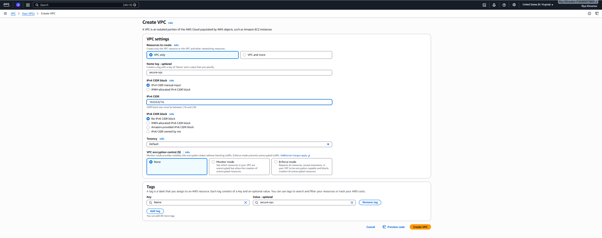

Public Subnet

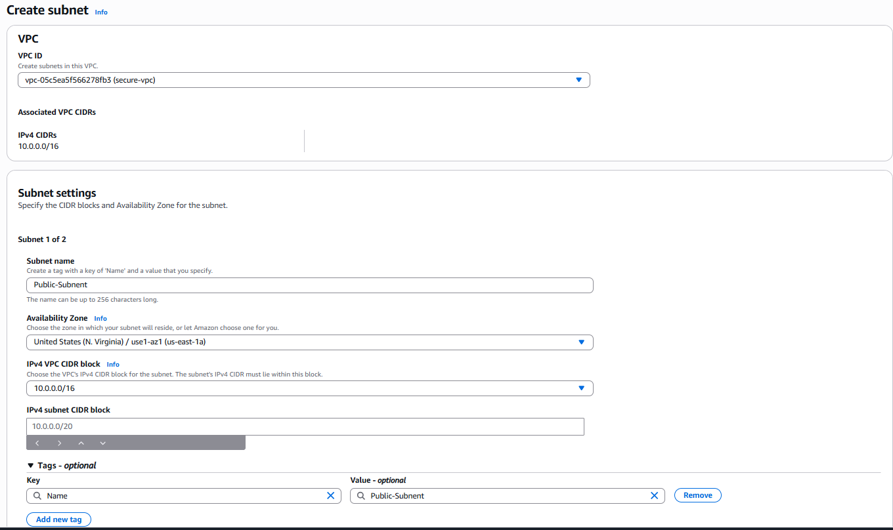

Private Subnet

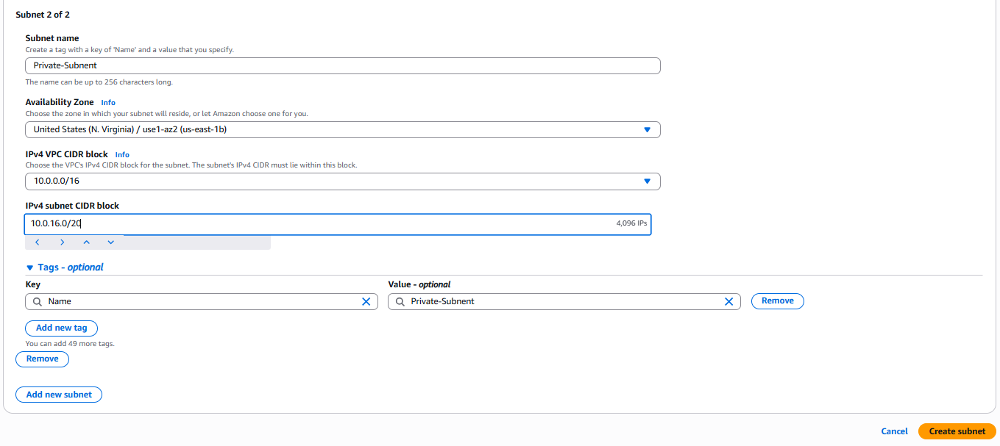

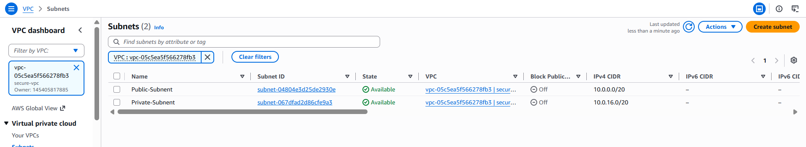
Internet Gateway

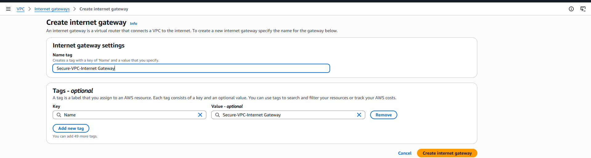

NAT Gateway

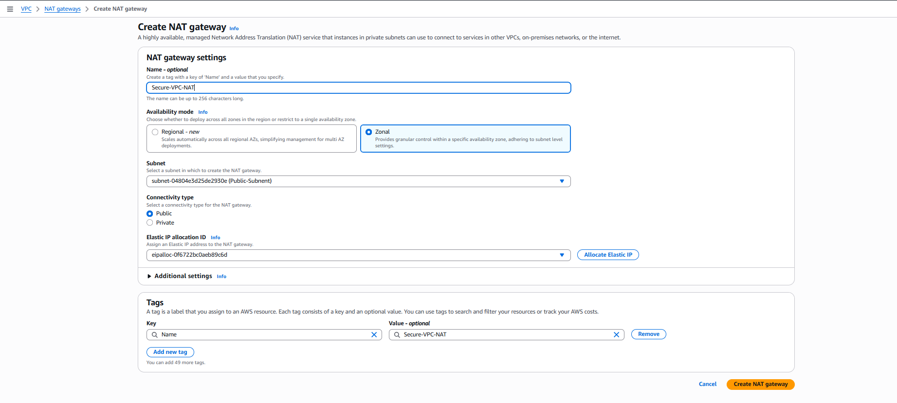

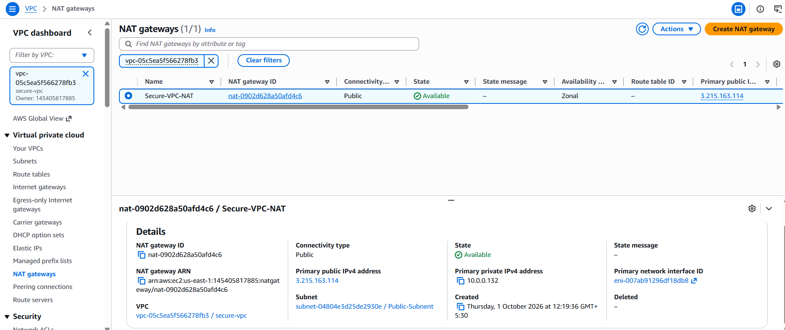

Public Route Table

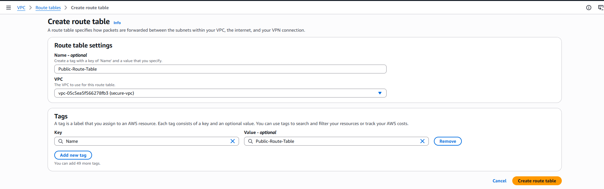

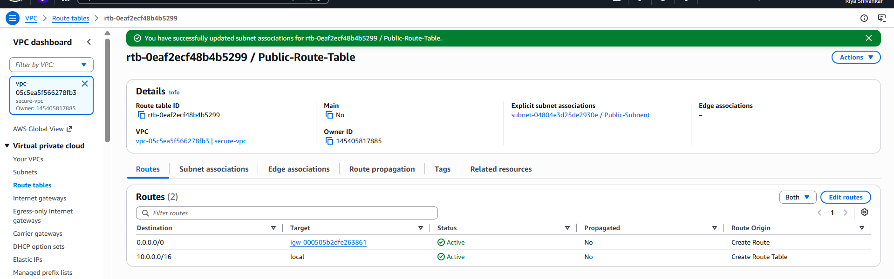

Private Route Table

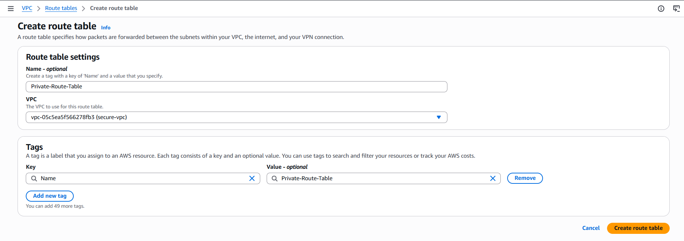

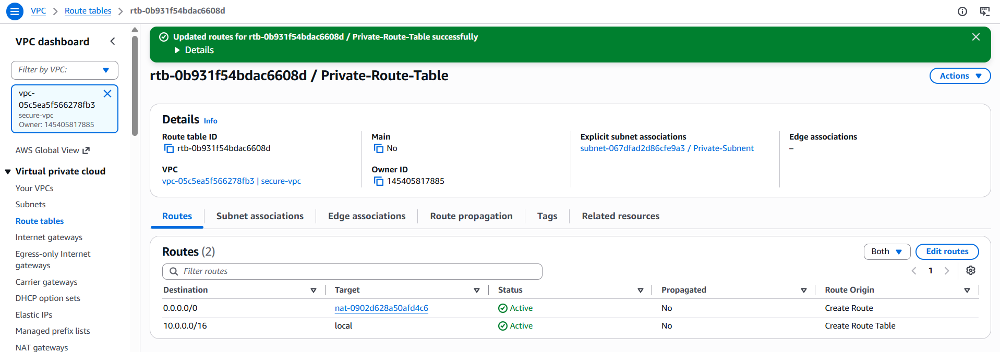

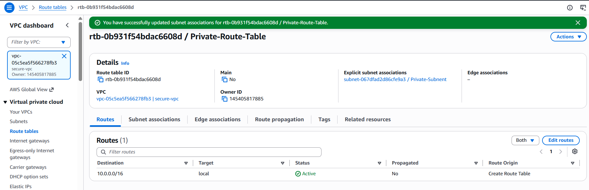

EC2 Instance (Private & Public)

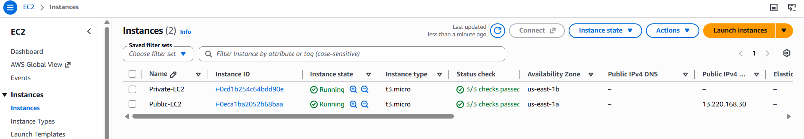

Connectivity Test

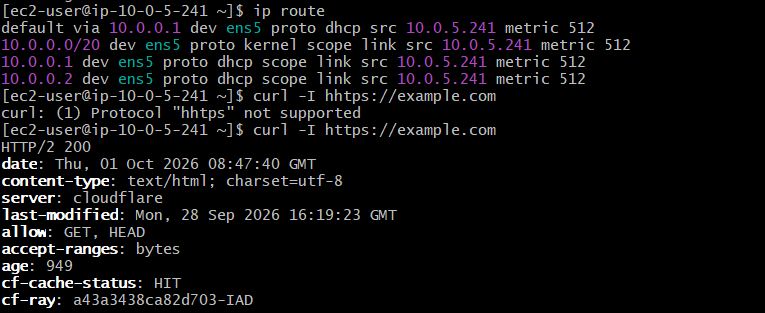

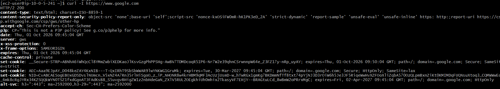

Resource Map

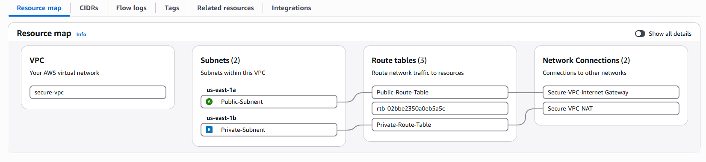

## 13. Complete Event Flow

The complete workflow of the project was performed in the following sequence:

1. Created a custom VPC with CIDR block "10.0.0.0/16".
2. Created a Public Subnet with CIDR "10.0.1.0/24".
3. Created a Private Subnet with CIDR "10.0.2.0/24".
4. Created and attached an Internet Gateway to the VPC.
5. Created a Public Route Table and added:
   0.0.0.0/0 → Internet Gateway
6. Associated the Public Route Table with the Public Subnet.
7. Created an Elastic IP for the NAT Gateway.
8. Created the NAT Gateway inside the Public Subnet.
9. Created a Private Route Table and added:
   0.0.0.0/0 → NAT Gateway
10. Associated the Private Route Table with the Private Subnet.
11. Launched a Public EC2 instance in the Public Subnet with a public IPv4 address.
12. Launched a Private EC2 instance in the Private Subnet without a public IPv4 address.
13. Configured Security Groups for controlled access.
14. Connected to the Public EC2 using SSH.
15. Tested internet connectivity from the Public EC2.
16. Accessed the Private EC2 through the private network as required for testing.
17. Tested outbound internet connectivity from the Private EC2 through the NAT Gateway.
18. Verified that the Private EC2 did not have direct public internet access.
19. Verified the route tables, subnet associations, EC2 networking, and NAT Gateway configuration.

## 14. Configuration Summary

    Component                Configuration
     VPC                    "10.0.0.0/16"
     Public Subnet          "10.0.1.0/24"
     Private Subnet         "10.0.2.0/24"
     Internet Gateway        Attached to VPC
     NAT Gateway             Deployed in Public Subnet
     Elastic IP              Associated with NAT Gateway
     Public Route           "0.0.0.0/0 → Internet Gateway"
     Private Route          "0.0.0.0/0 → NAT Gateway"
     Public EC2              Public IP enabled
     Private EC2             Public IP disabled
     Public EC2 Internet     Direct through IGW
     Private EC2 Internet    Outbound through NAT Gateway
     Security                for controlled access configured

## 15. Project Outcome 
The project demonstrates a basic secure and segmented AWS network architecture, where public resources can communicate directly with the internet while private resources remain isolated from direct inbound internet access and can use the NAT Gateway for controlled outbound connectivity.
This project helped develop practical understanding of AWS VPC, CIDR, subnets, route tables, Internet Gateway, NAT Gateway, EC2 networking, public/private IP addresses, and Security Groups.

## 16. Conclusion

This project demonstrates how to create a secure AWS network using a custom VPC with public and private subnets.

The Public Subnet uses an Internet Gateway to provide direct internet connectivity to the public EC2 instance.

The Private Subnet does not expose the private EC2 instance directly to the internet. Instead, the private EC2 uses a NAT Gateway for outbound internet connectivity.

This architecture provides a basic foundation for designing secure and scalable AWS cloud environments.

